<p align="center">
  
</p>

<p align="center">
  <b>Kuzuzangpo la!</b> 🙏🇧🇹<br>
  <i>I build backend systems that talk in events, from the Land of the Thunder Dragon:<br>
  services that publish facts, consume them reliably, and keep working when a message crosses the bridge twice.</i>
</p>

<br>

### 📿 The mani wall so far

Every turn of a prayer wheel sends its prayer out one more time. That's at-least-once delivery, so my stack lives on a mani wall:

<p align="center">
  
</p>

<br>

### 🏹 Arrows that missed

Archery is Bhutan's national sport, and the misses teach more than the hits. These are mine:

> `miss ×1` **At-least-once means at-least-twice.** Every consumer is idempotent, or the duplicate will find it.
>
> `miss ×2` **Never write to the database and the broker separately.** Sooner or later only one of them succeeds. That's what the outbox is for.
>
> `miss ×3` **An event is a fact, not a command.** Name it in the past tense and never rewrite history.
>
> `miss ×4` **"Eventually consistent" still needs an owner.** Someone has to know how long "eventually" is allowed to be.
>
> `miss ×5` **Decide what happens in the dead-letter queue before production decides for you.**

<br>

### 🌶️ Still simmering

Like a good pot of ema datshi, some things can't be rushed:

```
$ nats sub "druk.udap.learning.>"
[#1] druk.udap.learning.event-sourcing   rebuilding state from the log, not the table
[#2] druk.udap.learning.cqrs             separating the write model from the questions people ask
[#3] druk.udap.learning.outbox           never losing an event between commit and publish
[#4] druk.udap.building.platform         a microservice platform on NATS JetStream
```

<details open>
<summary><b>🏯 Dzong config: what I run on</b></summary>
<br>

**Build:** NestJS · TypeScript · Node.js · GraphQL<br>
**Store:** PostgreSQL · Redis · Prisma · TypeORM<br>
**Move:** NATS JetStream · Redis Streams · Kafka · BullMQ<br>
**Ship:** Docker · AWS · Nginx · Linux<br>
**Document:** Swagger · Postman

**Patterns:** event-driven architecture · CQRS · event sourcing · outbox · microservices · domain-driven design · clean architecture

</details>

<details open>
<summary><b>🐍 Contribution log</b></summary>
<br>

<picture>
  <source media="(prefers-color-scheme: dark)" srcset="https://raw.githubusercontent.com/Udap-10/Udap-10/output/github-contribution-grid-snake-dark.svg" />
  <source media="(prefers-color-scheme: light)" srcset="https://raw.githubusercontent.com/Udap-10/Udap-10/output/github-contribution-grid-snake.svg" />
  
</picture>

</details>

<br>

<p align="center">
  <a href="https://linkedin.com/in/udap-kharka-456167376">💼 LinkedIn</a>
  &nbsp;·&nbsp;
  <a href="mailto:udapkharka64@gmail.com">✉️ udapkharka64@gmail.com</a>
</p>

<p align="center"><sub><i>Tashi Delek 🙏 Build systems that scale, write code that lasts, and optimise for Gross National Happiness: fewer 2 a.m. pages for everyone.</i></sub></p>
