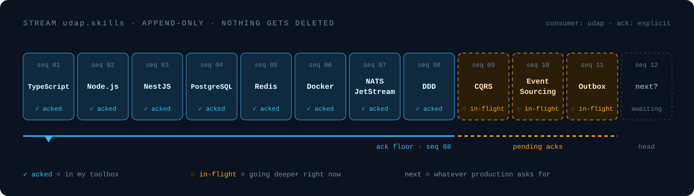

<p align="center">
  
</p>

<p align="center">
  <i>I build backend systems that talk in events: services that publish facts, consume them reliably,<br>
  and keep working when a broker restarts, a message arrives twice, or another service is down.</i>
</p>

<br>

### 📜 The log so far

<p align="center">
  
</p>

<br>

### 📬 Dead-letter queue

Some messages only get processed after a few failures. These are mine:

> `nak ×1` **At-least-once means at-least-twice.** Every consumer is idempotent, or the duplicate will find it.
>
> `nak ×2` **Never write to the database and the broker separately.** Sooner or later only one of them succeeds. That's what the outbox is for.
>
> `nak ×3` **An event is a fact, not a command.** Name it in the past tense and never rewrite history.
>
> `nak ×4` **"Eventually consistent" still needs an owner.** Someone has to know how long "eventually" is allowed to be.
>
> `nak ×5` **Decide what happens in the DLQ before production decides for you.**

<br>

### 🔁 Currently consuming

```
$ nats sub "udap.learning.>"
[#1] udap.learning.event-sourcing   rebuilding state from the log, not the table
[#2] udap.learning.cqrs             separating the write model from the questions people ask
[#3] udap.learning.outbox           never losing an event between commit and publish
[#4] udap.building.platform         a microservice platform on NATS JetStream
```

<details>
<summary><b>🧾 Stream config: what I run on</b></summary>
<br>

**Build:** NestJS · TypeScript · Node.js · GraphQL<br>
**Store:** PostgreSQL · Redis · Prisma · TypeORM<br>
**Move:** NATS JetStream · Redis Streams · Kafka · BullMQ<br>
**Ship:** Docker · AWS · Nginx · Linux<br>
**Document:** Swagger · Postman

**Patterns:** event-driven architecture · CQRS · event sourcing · outbox · microservices · domain-driven design · clean architecture

</details>

<details>
<summary><b>🐍 Contribution log</b></summary>
<br>

<picture>
  <source media="(prefers-color-scheme: dark)" srcset="https://raw.githubusercontent.com/Udap-10/Udap-10/output/github-contribution-grid-snake-dark.svg" />
  <source media="(prefers-color-scheme: light)" srcset="https://raw.githubusercontent.com/Udap-10/Udap-10/output/github-contribution-grid-snake.svg" />
  
</picture>

</details>

<br>

<p align="center">
  <a href="https://linkedin.com/in/udap-kharka-456167376">💼 LinkedIn</a>
  &nbsp;·&nbsp;
  <a href="mailto:udapkharka64@gmail.com">✉️ udapkharka64@gmail.com</a>
</p>

<p align="center"><sub><i>Build systems that scale. Write code that lasts. Ack every message.</i></sub></p>
